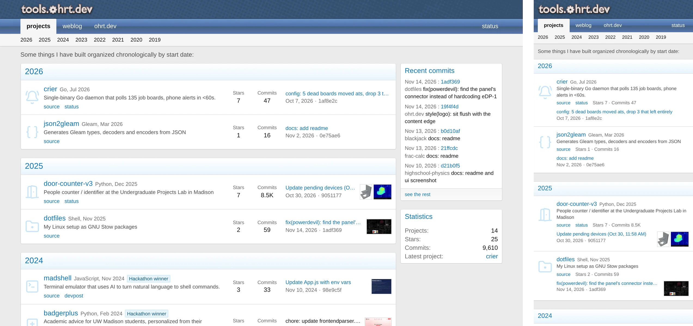

# tools.ohrt.dev

<p align="center">
  <a href="https://tools.ohrt.dev"></a>
</p>

<p align="center">
  <a href="https://github.com/Lavanic/tools.ohrt.dev/actions/workflows/deploy.yml"></a>
  <a href="https://tools.ohrt.dev"></a>
  <a href="https://github.com/Lavanic/tools.ohrt.dev/commits/main"></a>
  <a href="https://astro.build"></a>
  <a href="https://pages.github.com"></a>
</p>

My projects page, laid out like the index of a 2010 forum. Written in [Astro](https://astro.build), every page is a plain static file. Each project is one Markdown file in [`src/content/projects/`](src/content/projects), and its stars, commit count and latest commit are read from GitHub when the site is built.

## Development

```sh
npm install
npm run dev
```

Runs at `localhost:4321`. `npm run check` type-checks and `npm run format` runs Prettier.

## Deployment

Automatically deployed to GitHub Pages on every push to `main`, plus a rebuild every six hours so the numbers stay fresh.
